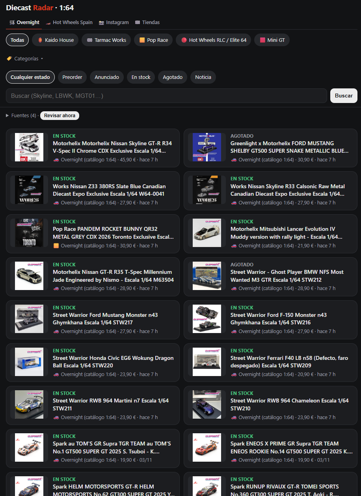
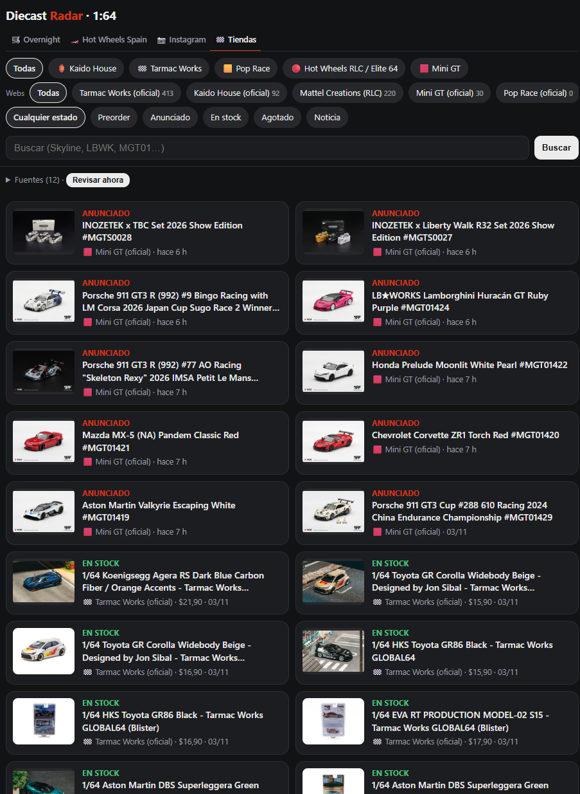
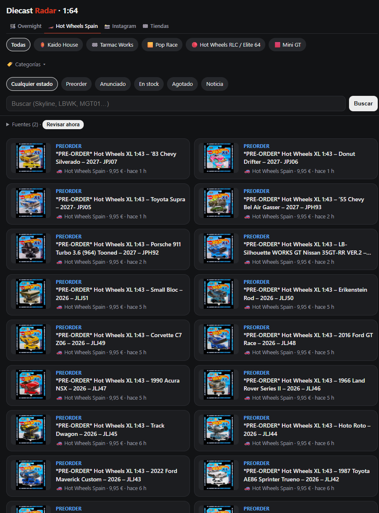

# Diecast Radar

Bot que vigila **lanzamientos y preorders de coches de colección a escala 1:64** en webs oficiales de fabricantes y tiendas españolas, y avisa al móvil en segundos con una app Android propia.

## Qué hace

- **Monitoriza tiendas y fabricantes** detectando automáticamente la plataforma de cada web (Shopify, WooCommerce, PrestaShop o web propia) y leyendo sus catálogos sin navegador.
- **Detecta tres eventos**: modelo nuevo, preorder abierto y producto agotado que vuelve a estar disponible. La primera pasada de cada fuente guarda el catálogo sin avisar, para notificar solo novedades reales.
- **Vigila Instagram** de cuentas oficiales y tiendas, y clasifica si un post o una historia es un anuncio de lanzamiento usando el texto y OCR de la imagen.
- **Filtros configurables** por marca, escala y palabras clave, con exclusión de merchandising.
- **Avisos ricos** con foto, precio y enlaces, con horas de silencio y agrupación en resumen si hay muchos a la vez.
- **Panel web** para el móvil con filtros y revisión manual, y alta de nuevas tiendas desde el propio panel.

## Capturas

<table>
  <tr>
    <td align="center"></td>
    <td align="center"></td>
    <td align="center"></td>
  </tr>
  <tr>
    <td align="center">Tienda española</td>
    <td align="center">Webs oficiales</td>
    <td align="center">Preorders</td>
  </tr>
</table>

## Arquitectura

```
 Shopify · WooCommerce · PrestaShop · webs propias · Instagram
                         │
                         ▼
            Servidor Python (Raspberry Pi)
            ├─ conectores por plataforma (sources/)
            ├─ detección de eventos + OCR
            ├─ SQLite
            └─ panel web + /api/events (long-poll)
                         │  Tailscale
                         ▼
               App Android (Kotlin)
```

## Tecnologías

- **Backend**: Python 3, Flask y Waitress, Requests, BeautifulSoup, PyYAML; SQLite.
- **Scraping**: APIs JSON públicas de cada plataforma, con HTML como alternativa y `curl_cffi` para webs con protección antibots.
- **OCR**: Tesseract para leer el texto de las imágenes y clasificar anuncios.
- **App**: Android nativo en Kotlin, con servicio persistente, arranque automático y canales de notificación.
- **CI/CD**: GitHub Actions compila la APK.
- **Infraestructura**: Raspberry Pi, servicio `systemd`, Tailscale.

## Estructura

```
radar/
  sources/      conectores (shopify, woocommerce, prestashop, minigt, instagram)
  detect.py     detección de eventos
  ocr.py        lectura de texto en imágenes
  notify.py     avisos
  web.py        panel y API
android/        app Android
config.example.yaml
```

## Puesta en marcha

```bash
cp config.example.yaml config.yaml
bash install.sh
.venv/bin/python -m radar check   # prueba las fuentes sin guardar nada
```

La guía completa está en [INSTALACION.md](INSTALACION.md).
